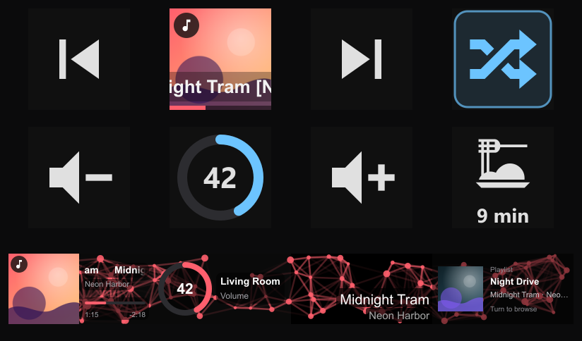
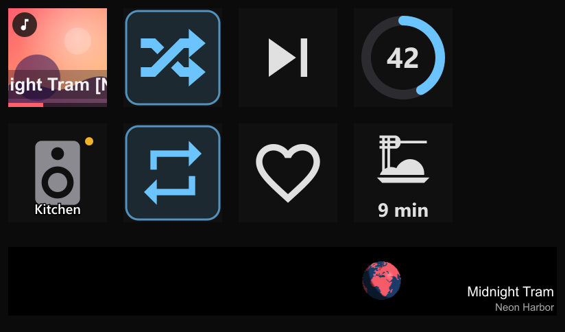
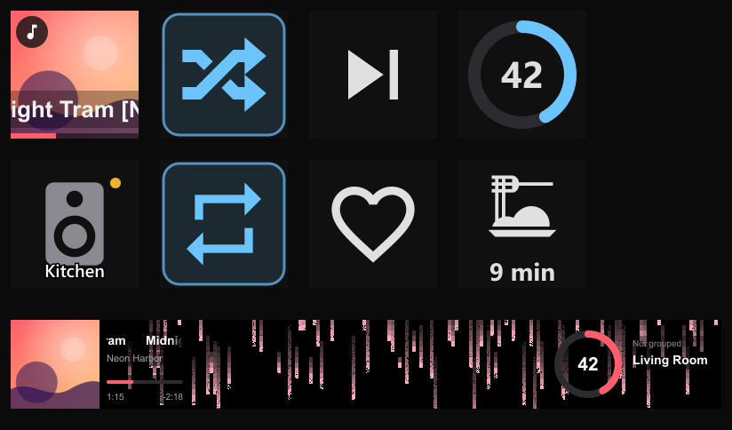
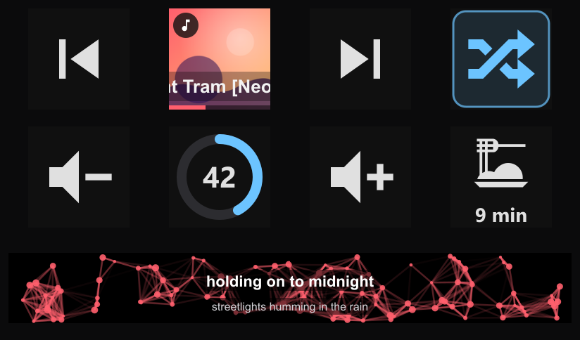
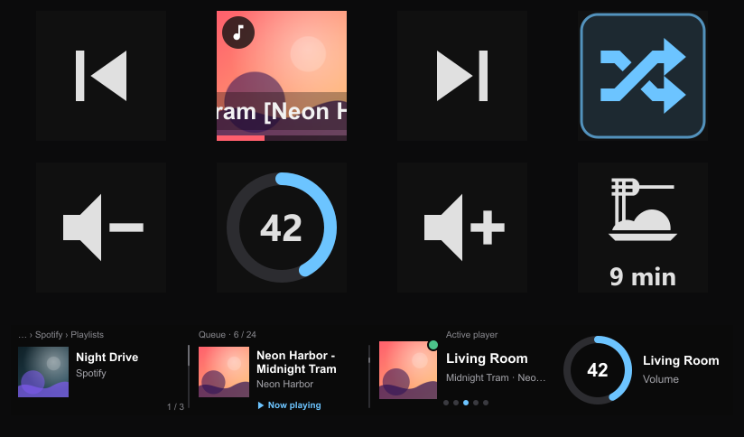

# Music Assistant Controller (MA-C) for Elgato Stream Deck

Control **[Music Assistant](https://www.music-assistant.io/)** from your Stream Deck. Every speaker and every streaming service in one deck, with cover art, live state and physical buttons.


[](LICENSE)

> **Disclaimer:** This is an independent, community-made plugin. It is not affiliated with, endorsed by, or officially connected to the Music Assistant project or Elgato in any way.

> **Status:** MA-C is in early development, heading for its first release. All actions work and are tested against a live Music Assistant server and on a Stream Deck +. See the [roadmap](#roadmap).



---

## Why MA-C?

Music Assistant brings Spotify, Tidal, Qobuz, radio, podcasts, audiobooks and your own files together in **one library**. It plays them on almost any speaker: Sonos, AirPlay, Chromecast, Squeezebox, DLNA and more, all in the same house.

MA-C puts that on physical buttons and dials:

- **One plugin for all speaker brands.** Any player that Music Assistant knows about can be controlled from the deck.
- **Live state.** Keys update instantly through Music Assistant's event stream, so there is no polling.
- **"Active player" concept.** A whole deck profile can follow one switchable player, so you don't have to configure each key.
- **Beyond remote control:** a Like key, "Don't stop the music", crossfade, "music follows me" from room to room, synced lyrics across the dials, and announcements with a timer.

MA-C is the sister project of **[Sonos Controller](https://github.com/rocklobster42195/streamdeck-sonos-controller)** and shares its UI foundation.

---

## Screenshots

| | |
|---|---|
|  |  |
| **Panorama:** one scene across neighbouring dials, with the title or synced lyrics on top | **Effect backgrounds** behind any dial, here Matrix Rain |
|  |  |
| **Synced lyrics** across the Panorama dials, in time with the music (invented lyrics here) | **Browser, Queue, Active Player** and **Volume** on the dials |
|  | |
| Everyday keys: previous, play/pause with cover, next, shuffle, volume down/mute/up, a pasta timer | |

The screenshots are rendered by the simulator against a stand-in Music Assistant with invented music and generated covers (`node tools/sd-sim/showcase.mjs`).

---

## Actions

All keys have a **Colour** for their icons: **Default** (light grey, blue when on, as before), **Cover** (the colour of what is playing; for a Sonos speaker the same colour Sonos Controller shows), **Like Panorama** (the row colour of this Stream Deck, so keys and dials match) or a **fixed** colour. Keys that had **Cover color** switched on take **Cover** over. A **marker** (any Material Design Icon, e.g. a pot for the kitchen) tells keys apart: it sits in the top-right corner, in the center of the mute key's ring when that shows no number, and on the Player key it replaces the speaker as the room's icon. The Volume and Group Volume dials show it in front of their second line.

| Action | Controller |
|---|---|
| **Play / Pause**: cover art, live play state, optional progress bar and player name | Key |
| **Playback Control**: next · previous · shuffle · repeat · crossfade · "Don't stop the music" | Key |
| **Volume**: up · down · mute · preset | Key |
| **Play Item**: play any playlist, album, radio station or podcast from your library | Key |
| **Like**: add the current track to your favorites; the heart fills when it already is one | Key |
| **Player**: one key per room; makes it the active player and brings the music along | Key |
| **Continue Listening**: resume your latest audiobook or podcast episode where you left off | Key |
| **Sleep Timer**: each press steps 15 → 30 → 60 → 90 min → off, with a countdown and a fade-out at the end | Key |
| **Source**: switch a speaker to Line-in, TV or another input | Key |
| **Announcement**: speak a message on one or all speakers (TTS), at once or after a **timer**, with an icon of your choice | Key |
| **Cast Dashboard**: show "now playing", party or music quiz on a TV | Key |
| **Track**: cover, title and progress on the display, rotate to seek | Dial (SD+) |
| **Volume**: rotate to change, push to mute, touch for a preset; as a ring or a pie, optionally in the cover color | Dial (SD+) |
| **Group Volume**: volume and mute for a whole speaker group | Dial (SD+) |
| **Browser**: browse every provider or your library with the dial and play what you find | Dial (SD+) |
| **Queue**: scroll through the queue and jump to any track | Dial (SD+) |
| **Active Player**: choose the active player with a turn, bring the music here | Dial (SD+) |
| **Panorama**: ambient effects spanning neighbouring dials, tinted by the cover, with the title or **synced lyrics** on top | Dial (SD+) |

### Play / Pause

Toggles playback of the selected player. While playing, the key shows the cover art of the current track or station. When paused, the cover is dimmed and a play symbol appears. The key reacts immediately when pressed and then syncs with what Music Assistant reports.

The settings panel shows a **live preview of the key** together with what is playing and where. The player picker shows the current state of every player (playing, paused, ready, offline). For keys set to "Active player", it also shows which player they currently follow.

| Setting | Description |
|---|---|
| Player | A specific player/group, or **Active player** (default) |
| Player name | Show the player's name as the key title |
| Title | Title and artist scroll along the bottom of the key |
| Progress | Thin progress bar at the bottom, tinted with the cover's accent color |
| Double and triple tap | Off by default. Two taps skip to the next track, three go back to the previous one; the key shows the skip symbol for a moment. A single tap then waits a moment before it plays or pauses (**Tap speed**: `Fast`, `Normal`, `Slow`) |

### Play Item

One press plays **any item from Music Assistant**: a playlist, album, radio station, podcast, track or audiobook, from any of your streaming services or your own files. The key shows the item's cover. While that item is playing, the key gets a blue frame and a ▶ tag.

The settings panel has a **library browser**. It opens on your favorites, and you can search across all your providers, with filters for playlists, albums, radio, podcasts, tracks and audiobooks, all shown with covers. Under **When pressed**, choose what happens: **Play now** (replaces the queue), **Play next** or **Add to queue**.

### Continue Listening

Picks up your **latest audiobook or podcast episode** where you left off, across all your players: Music Assistant remembers the position. The key shows the cover with the title scrolling along the bottom. Press to continue, press again to pause. While it plays, the key gets a blue frame and shows the progress.

Settings: **Show** both, only audiobooks, or only podcasts · **Name** on the key on or off · **Player**.

Audiobooks and podcasts come from Music Assistant's providers (for example Audiobookshelf, Audible, podcast feeds, or LibriVox via Internet Archive). A progress bar before you press appears when Music Assistant knows the position of the item, which is the case for items in your library.

### Playback Control

One key per function: **previous, next, shuffle, repeat, crossfade** or **"Don't stop the music"**. Toggles show their state: blue with a frame means on. Repeat cycles through off, all and one. Next and previous are dimmed while a live radio stream plays, because there is nothing to skip.

**Seek:** hold Next or Previous to switch the key to seeking. Every tap then jumps forward or back by the seek step (5, 10, 15 or 30 seconds); quick taps add up and go out as one jump, so six quick taps of 10 seconds jump a minute at once. The key shows the jump (`+1:00`) and otherwise where the track is. It switches back by itself after 3 seconds without a tap, or when you hold it again. Next and previous act when you let go of the key.

**Crossfade** only works when the player runs in Music Assistant's **flow mode**. Without it, Sonos speakers play the tracks one by one and the crossfade setting has no effect. The crossfade key's settings show whether flow mode is on for its player and can switch it; switching briefly restarts what is playing. Music Assistant never crossfades tracks from the same album unless that is allowed in its settings, and with Spotify some tracks may fail to play in flow mode.

### Volume

**Down, up, mute** or a **preset** volume. The key shows the current volume, which you can turn off. The mute key shows the volume as a ring like the Volume dial, or as a **pie** like in Sonos Controller (without the number); when muted, it turns grey with a red muted speaker inside. For down and up, the step per press can be set from 1 to 20 %. Several quick presses add up correctly.

### Like

Adds the current track or station to your Music Assistant **favorites**. The heart is filled when it already is a favorite, and pressing again removes it. Music Assistant also uses a heart for favorites.

### Volume dial *(Stream Deck + only)*

A ring shows the volume, with the number inside and the player's name next to it. The ring glides smoothly to each new value.

| Input | Effect |
|---|---|
| Rotate | Volume (step per tick adjustable, 1–10 %) |
| Push | Mute / unmute |
| Touch | Recall the preset volume |
| Touch and hold | Save the current volume as the preset |

Settings: **ring or pie** (the pie has no room for the number, so it moves next to it), show or hide the text (volume and name), and where the ring sits (left, center or right).

### Track dial *(Stream Deck + only)*

Shows the cover, the title and the artist (scrolling when they are too long), and a progress bar in the cover's accent color. Live radio shows **LIVE** instead of a progress bar.

| Input | Effect |
|---|---|
| Rotate | Seek (seconds per tick adjustable) |
| Push | Next track |
| Touch | Play / pause |

### Player (room key) and Active Player dial

**Music follows you.** Put one **Player** key per room on your deck. Pressing it makes that room the **active player**, and every key and dial set to "Active player" now controls it. With **Bring the music along** (on by default), whatever the previous active player was playing moves to this room too. The active room's key has a blue frame, and a dot shows its state (playing, paused, ready, offline).

The **Active Player** dial does the same with a turn. Rotate to choose the active player. **Push** brings the music here from wherever it is playing. **Touch** is play/pause.

### Queue dial *(Stream Deck + only)*

The queue as a list that scrolls smoothly, one track per click of the dial: cover, title and artist, with the selected track in the middle. The track that is playing has its title in blue and a small wave next to it. **Push** plays the selected track, and **touch** jumps back to the current one. After a few seconds without input, the list glides back to the current track on its own. **Show covers** can be switched off (icons only).

### Group Volume dial *(Stream Deck + only)*

Controls the volume of the **whole group** the player belongs to, and shows the group's rooms ("Group · 2 rooms"). Rotate for volume, push to mute the group, touch for a preset (hold to save it). A player that isn't grouped is controlled on its own. Like the Volume dial, it shows the volume as a ring or a pie.

### Panorama dial and effect backgrounds *(Stream Deck + only)*

Four ambient effects: **Particles**, **Matrix Rain**, **Boing Ball** and **Boing Globe**. Neighbouring dials with the same effect share **one continuous scene** across the touch strip. Changing the effect on one of them, or turning it off, switches all connected displays (turn off **Apply to connected displays** to change just one). Rotating a Panorama dial changes the effect, for example its speed, and the dial remembers the change. Where there is more than one thing to change (particle count and speed, or the lyrics timing), pushing switches between them; a small badge at the top shows which one is active. With **Lyrics** on, turning adjusts the lyrics timing (a scale at the top shows it), and tapping the display re-syncs the lyrics with Music Assistant when they have fallen behind. The row's **Colour** is set in the Panorama section: **Cover** (the colour of what the active player plays, or of one chosen player), a **fixed** colour, or the effect's own. MA-C shares its players' cover colours with the other plugins, so a row of only X-Air or System Audio dials can follow the cover too. Choose **No effect** for plain text (title or lyrics) on black; neighbouring Panorama dials without an effect still share one line.

**Text** puts the music of the chosen **Player** (default: the active player) on top of the effect:

- **Title**: title and artist, bottom right. A new song fades in.
- **Lyrics**: the line being sung, large, with the next line below it, in time with the music. Neighbouring Panorama dials share **one line across all their displays**. On a single dial, long lines wrap. Lyrics come from Music Assistant's metadata providers (for example [LRCLIB](https://lrclib.net), enabled by default), so they work for many well-known songs but not for everything. Without lyrics (radio, audiobooks, less-known tracks), the dial shows title and artist instead. The first lookup of a song can take a few seconds, so MA-C fetches the lyrics of the next song in the queue ahead of time. If the lyrics run ahead of or behind the music (speakers buffer audio), adjust **Timing**.

The **Track**, **Volume**, **Group Volume**, **Queue**, **Browser** and **Player** dials can show an effect as their **background** (dimmed, so the text stays readable). Put them next to Panorama dials with the same effect, and the scene runs underneath everything.

**Moves with:** the effect can move with the music. Pick a level another plugin offers (see [Works with other plugins](#works-with-other-plugins-deckbus)), for example a mixer channel from X-Air Controller or your computer's sound from System Audio Controller. The picture and colours still come from the dial's player: MA-C gives the look, the other plugin the beat. The setting appears only while another plugin offers a level, or while one is chosen (then it says when that plugin isn't running). Particles and Matrix Rain get faster when it is loud, the Boing Ball jumps higher, pulses and squashes on the beat, and the Boing Globe spins faster. MA-C adapts to how loud the source is: a quiet mixer channel moves the effect as much as a loud one. With **Nothing** (the default), or when the source goes away, the effect moves as usual.

### Browser dial *(Stream Deck + only)*

Browse **every provider** in Music Assistant (radio directories, streaming services, your files) or your **library**, right on the dial. The first folder, **Continue listening**, holds the audiobooks and podcast episodes you started. The entries are a list that scrolls smoothly, one entry per click of the dial, with the selected one in the middle; when you open a folder, the display shows briefly where you are ("… › By tag › Jazz"). What is playing (the track, or the playlist or album it was started from) has its title in blue and a small wave next to it, and a folder opens on it. After playing something, the list stays open. Under **Services** you choose which music services show up (for example only Spotify): the provider list and your library folders then leave the others out.

| Input | Effect |
|---|---|
| Rotate | Scroll through the entries |
| Push | Open a folder, or play the entry |
| Touch | One level back |
| Touch and hold | Back to the start |

When idle, the dial shows what is playing. The first turn continues browsing where you left off. After a configurable time without input it returns to "now playing".

Settings:
- **Start at**: all providers, or your library (favorites, playlists, albums, radio, podcasts, audiobooks, tracks)
- **When pressed**: play now, play next or add to queue
- **Playable folders**: open them or play them
- **Timeout**: seconds without input before returning to "now playing"
- **Show covers**: off shows icons only

Providers that can't be browsed are hidden automatically.

### Sleep Timer, Announcement, Source, Cast Dashboard

- **Sleep Timer:** Each press sets the next duration (default 15, 30, 60 and 90 minutes; configurable). After the last one, the timer switches off. While running, the key counts down the time left (minutes and seconds). At the end, the whole group fades out (30 seconds by default, adjustable, 0 = off), stops, and every speaker gets its own volume back for next time. The fade needs Stream Deck running; without it, Music Assistant still stops playback on time, just without fading.
- **Announcement:** Speaks your text on the chosen player or **on all players**, with an optional chime and its own volume. The voice comes from a TTS engine in Home Assistant or Music Assistant, which you pick in the settings.
- **Source:** Switches a player to one of its inputs (e.g. Line-in on a Sonos Five, or TV). The key lights up while that input is active. Only inputs you can actually select are offered.
- **Cast Dashboard:** Shows a Music Assistant dashboard ("Now playing", "Party" or "Music quiz") on a screen that Music Assistant knows, such as a Chromecast TV. Press again to take it down.

### Status on the keys

When a key can't do its job, it tells you: **Setup** means connection details are missing, **Offline** means the server is not reachable (MA-C reconnects automatically), **Token?** means the token was rejected, and **No player** means no player is selected or the player is gone.

---

## Works with other plugins (deckbus)

MA-C talks to other Stream Deck plugins on your computer through **deckbus**, a small open bus between plugins. You don't need to set anything up: when the plugins run, they find each other.

**Offers:** whether MA-C is connected to Music Assistant, and its **players**: what each one plays (title, cover, position, volume), so other plugins' keys can show and control them, for example a Sonos Controller key that you point at your TV's player in Music Assistant. Controlling them is on by default. A Sonos speaker that both plugins know counts once: commands go through Sonos Controller (directly to the speaker), title and cover come from MA-C while Music Assistant plays on it.

**Uses:** audio levels for the Panorama's **Moves with**, for example the channels of your mixer from X-Air Controller. MA-C subscribes to a level only while a Panorama dial that uses it is visible.

**Only with your permission:** nothing yet. Later, the Announcement key may ask a mixer plugin to lower the music while it speaks. That will need your OK.

deckbus stays on your computer. It uses local pipes (Windows) or sockets (macOS), plugins must know a key stored in your user profile, and nothing goes over the network. The protocol is open: [deckbus protocol](https://github.com/rocklobster42195/streamdeck-kit/blob/main/docs/deckbus-protocol.md).

## Requirements

- Elgato Stream Deck app **7.1** or later (Windows 10+ or macOS 12+)
- A running **Music Assistant server 2.10 or later**, either standalone or as a Home Assistant add-on
- A **long-lived access token** from Music Assistant

## Setup

**Install:** download the `.streamDeckPlugin` file from the [latest release](../../releases/latest) and double-click it. **Beta builds** for testing new features are published as [pre-releases](../../releases); they install the same way and are replaced by the next stable release.

1. In Music Assistant, open **Settings → Profile** and create a **long-lived token**. Name it, for example, "Stream Deck".
2. Drag any MA-C action onto your Stream Deck. Its settings panel guides you through two steps:
   - **Server address**: the address of your Music Assistant server, e.g. `192.168.1.10` or `192.168.1.10:8095`. Port `8095` is used when you leave it out.
   - **Token**: the token from step 1
3. Click **Connect**. The panel shows the result right away: connected (with server version and player count), server not reachable, or token rejected.
4. Under **Music Assistant → Change**, pick the **Active player**. Keys set to "Active player" control this player.

The connection settings are shared by all MA-C keys, so you only enter them once.

> Running Music Assistant as a Home Assistant add-on? Use the IP of your Home Assistant host with port `8095`.

---

## Roadmap

Have an idea? [Open an issue](../../issues/new/choose).

---

## Translations

MA-C ships in **English** and **German**. Each language is a **single JSON file**, so adding yours is easy. The **[translation page](translate/)** shows every text with where it appears, a live key preview and missing/outdated markers, and exports the finished file. See [TRANSLATING.md](TRANSLATING.md).

---

## Development

```
plugin/    The Stream Deck plugin (actions, property inspectors, manifest), an npm workspace
tools/     Dev scripts (simulator, PI preview, icon generation, API probe)
```

MA-C builds on two packages of its own:

- [`music-assistant-client`](https://github.com/rocklobster42195/music-assistant-client): the typed Music Assistant API client
- [`@rocklobster42195/streamdeck-kit`](https://github.com/rocklobster42195/streamdeck-kit): rendering helpers, animation, Panorama effects and the property inspector kit, shared with Sonos Controller and the plugins that follow. To work on the kit and MA-C at the same time, point `plugin/package.json` at a local checkout (`"file:../../streamdeck-kit/packages/kit"`) or use `npm link`.

```bash
npm install          # installs all workspaces
npm run build        # builds the plugin and the PI bundle
npm test             # vitest (plugin and tools)
npm run lint

# Stream Deck dev loop
npm run link -w mac-plugin    # link the .sdPlugin folder into Stream Deck (once)
npm run watch                 # rebuild and restart the plugin on every change

# Property inspector in a normal browser (fake Stream Deck + fake plugin data)
npm run pi:preview            # http://localhost:5199/play-pause-key.html?scenario=connected&lang=de
                              # scenarios: connected · setup · auth · offline — lang: en · de
```

### Property inspectors

The settings panels do not use `sdpi-components`. They are built on the framework-free property inspector kit from `@rocklobster42195/streamdeck-kit`:

- `@rocklobster42195/streamdeck-kit/pi`: the Stream Deck PI socket client, i18n, and light-DOM components (`<pi-section>`, `<pi-toggle>`, `<pi-field>`, `<pi-range>`, `<pi-choice>`, `<pi-color>`, `<pi-select>`, `<pi-icon-picker>`), and on the plugin side `piBridge`, which answers their requests
- `@rocklobster42195/streamdeck-kit/styles/pi-theme.css`: the shared dark theme

MA-C adds `<mac-key-preview>` (compact status header), `<mac-player-picker>` and `<mac-connection-card>` (`plugin/src/pi-ui/`). The plugin feeds these through a small message protocol (`plugin/src/pi/protocol.ts`, on top of the kit's own messages).

### Testing without hardware

`tools/sd-sim/` is a **Stream Deck simulator**. It runs the real `bin/plugin.js` against a fake Stream Deck app over the plugin WebSocket protocol, places actions on a virtual Stream Deck +, presses keys and turns dials. It records everything the plugin sends back (images, titles, feedback, alerts, PI messages) and renders the deck to PNG.

```bash
npm run build
npm run sim:play-pause    # end-to-end against your MA server (needs .env), snapshots in sim-out/
npm run sim:keys          # playback control, like and volume keys: presses everything, checks MA, restores state
npm run sim:play-item     # Play Item: search like the PI, choose, press, check it plays
npm run sim:dials         # Volume and Track dials: turn, push, touch, check MA, restore
npm run sim:deckbus       # Panorama audio source: a fake level source on deckbus, fake MA, no playback
npm run sim:browser       # Browser dial: RadioBrowser → By tag → Jazz → play a station, library start
npm run sim:players       # Player key/dial: switch the active player; with MA_TRANSFER_PLAYER also music-follows-me
npm run sim:queue-group   # Queue dial (jump to a track) and Group Volume dial (temporary group, restored afterwards)
npm run sim:list          # Browser and Queue dial lists: library, Albums, scrolling, back — read-only, no playback
node tools/sd-sim/motion.mjs sim-out   # frames over time: marquee on key and dial, gliding volume ring
node tools/sd-sim/panorama.mjs sim-out # panorama effects across dials and as dial backgrounds
npm run sim:all           # all of the above
npm run translate         # translation page at http://localhost:5399/translate/ (rebuilds translate/data.json)
npm run pi:live           # a PI page in your browser, wired to the REAL plugin and your MA (http://localhost:5299)
node tools/screenshot.mjs <url> <out.png> [--type "<sel>=<text>"] [--click <sel>]   # reliable PI screenshots
```

For API experiments, create a `.env` file (it is gitignored) with `MA_URL=http://<host>:8095`, `MA_TOKEN=<token>` and `MA_TEST_PLAYER=<player_id>`. The simulator plays quietly on that player. `npm run probe` records raw API traffic.

### Releases

Versions live in the plugin manifest (`A.B.C.D`, where `D` is the beta build number). Tags are semver: `v0.2.0`, or `v0.2.0-beta.1`.

```bash
npm run ship:beta     # check → next beta (0.2.1-beta.1, then -beta.2, …) → GitHub pre-release
npm run ship:patch    # check → release; while in beta, this promotes the beta line to stable
npm run ship:minor    # / ship:major
```

Each `ship:*` runs `npm run check` (build, tests, lint, validate), then `tools/bump-version.mjs` (manifest version, CHANGELOG `[Unreleased]` → version section for stable releases, commit and tag), then `tools/release.mjs` (push and GitHub release; betas as pre-releases). The **Release** workflow builds the plugin from the tag and attaches `de.boriskemper.music-assistant-controller-<tag>.streamDeckPlugin`. Stable releases are also packed locally into `release/` for the Elgato Marketplace upload, which has no beta channel. Release packages leave out the Node debug port (`tools/pack.mjs`). If only the publish step fails, fix it and re-run `npm run release`. The **CI** workflow runs the same checks on every push and pull request.

### `music-assistant-client`

The plugin talks to Music Assistant through **[music-assistant-client](https://github.com/rocklobster42195/music-assistant-client)** ([npm](https://www.npmjs.com/package/music-assistant-client)), a typed TypeScript client for the Music Assistant WebSocket API with no Stream Deck code. It lives in its own repository; to work on both at once, `npm link` it into this one.

```ts
import { MusicAssistantClient } from "music-assistant-client";

const ma = new MusicAssistantClient({ url: "http://192.168.1.10:8095", token: "…" });
await ma.connect(); // starts and waits until players and queues are loaded
await ma.playPause("RINCON_…");
```

---

## Contributing

Bug reports, ideas, translations, code and new panorama effects are all welcome. **[CONTRIBUTING.md](CONTRIBUTING.md)** explains how to report a bug well, set up the dev environment, test without a Stream Deck (simulator and PI preview), and open a pull request. For effects, see **[CONTRIBUTING_EFFECTS.md](CONTRIBUTING_EFFECTS.md)**.

---

## Related projects

- **[Sonos Controller](https://github.com/rocklobster42195/streamdeck-sonos-controller)**: the sister plugin for Sonos systems ([Elgato Marketplace](https://marketplace.elgato.com/product/sonos-controller-083f868f-c0b5-43bc-8db5-ba287254fce5))
- **[JS Automations for Home Assistant](https://github.com/rocklobster42195/ha-js_automations_addon)**: write Home Assistant automations in JavaScript/TypeScript

## Credits

- [Music Assistant](https://www.music-assistant.io/): the server that makes all of this possible
- Icons: [Material Design Icons](https://pictogrammers.com) (Pictogrammers)
- [ws](https://github.com/websockets/ws)

## License

[MIT](LICENSE) © Boris Kemper
